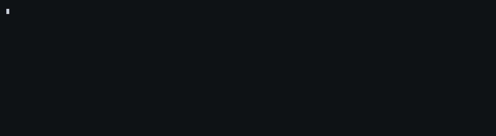

# boxfit



Measure the computer you own today on the model you want, and boxfit prints what each
desk computer would do with that model: whether it fits, the seconds before the first
token, and the tokens per second after it.

> **Status:** `test_boxfit.py` passes, and CI reruns it plus the issue's coding-agent example on
> Python 3.9 and 3.12 on every push. A fresh clone runs on stock `python3`. Checked against one
> measured run (NVIDIA's Qwen3.6 35B A3B on a DGX Spark, below). The M5 Ultra row is a projection.
> Its log readers are tested on lines in each tool's documented format, and the three logs in
> `examples/` are hand-written workload files: no captured log has run through it yet.

Companion to [Mac Studio vs DGX Spark vs RTX 5090](https://theaiengineer.substack.com/), The AI Engineer.

For engineers pricing a desk machine for local inference, an RTX 5090, an RTX PRO 6000,
a Mac Studio or a DGX Spark, who want to know which one their own workload stalls on
before they pay for it.

Point it at two files you already have: your model's `config.json` and a log from the
machine you run today (Ollama `--verbose` output, Ollama's `server.log`, a llama.cpp
`llama-server` or `llama-cli` log, or `mlx_lm.generate --verbose` output):

```
python3 boxfit.py config.json my-run.log
```

On the known case in `examples/`, one 2,048-token request to Qwen3.6 35B A3B, it prints:

```
box                        fits          first token   tokens/s     own/yr         rent/yr     
DGX Spark 128GB            yes           0.5 s         88.2         $2,360         $0          
```

It prints, per box, whether the model fits, the seconds before the first token, the
tokens per second after it, and what a year of your actual use costs to own against
renting the same hours. Every number is arithmetic you can redo by hand; `--explain`
prints the working.

## What it reads, and what it does not

- `config.json` gives the architecture: layers, heads, experts, experts per token,
  sliding-window and linear-attention layers. From it boxfit counts total and active
  parameters and the KV cache each token of context adds.
- The log gives your workload and your quantization: prompt tokens and generated
  tokens per request, your current machine's measured speeds, and, for llama.cpp and
  Ollama, the file size and tensor types of the weights you actually run.
- It never loads the model, never needs a GPU, never calls an API. Standard-library
  Python 3.9 or newer.

## How the numbers are made

Decode is memory-bound: each token reads the active weights plus the KV cache, so
tokens per second = measured efficiency x memory bandwidth / bytes read per token.
Prefill is compute-bound: seconds to first token = the prompt's matrix-multiply work
plus its attention work, each divided by the throughput measured on that box.

The efficiencies are not guesses. Each box's row in `BOXES` carries the published run
it was calibrated on, and every run used the same model, gpt-oss-120b:

| box | calibration run | source |
|---|---|---|
| DGX Spark | llama.cpp, build 7941, pp and tg at depths 0 to 32,768 | github.com/ggml-org/llama.cpp, benches/dgx-spark (Feb 2026) |
| Mac Studio M5 Max | mlx_lm on a 128GB, 40-core M5 Max, 4k to 32k | hardware-corner.net (Mar 2026) |
| RTX PRO 6000 | llama.cpp pp to 32,768; tg at 4k to 32k | llama.cpp discussion 15396 (Aug 2025); hardware-corner.net (Mar 2026) |
| RTX 5090 | PRO 6000 bus and die scaled by SM count; spill anchors from a 5090 run | hardware-corner.net (Nov 2025); llama.cpp discussion 15396 |
| Mac Studio M5 Ultra | projected from the M5 Max: the September 2026 reviews measured other models | Apple, 25 Aug 2026 |

## Check it on a case you already know

`python3 test_boxfit.py` must print `OK`. The known case the README states in full:

```
python3 boxfit.py examples/qwen3.6-35b-a3b-nvfp4.config.json examples/qwen36-2k.log --only spark
```

NVIDIA's August 2026 DGX Spark Reviewer's Guide measured Qwen3.6 35B A3B on one Spark
at 101.8 tokens per second with a 2k context. boxfit, calibrated on a different model
(gpt-oss-120b) and a different engine (llama.cpp), predicts 88.2. The 13 percent gap is
NVIDIA's three-token speculative decoding, which boxfit does not model, so on a box
running speculation expect the measured number to beat the prediction.

The issue's own scenario, a coding agent re-sending 30,000 tokens of repository context
to gpt-oss-120b 200 times a day, is the other example:

```
python3 boxfit.py examples/gpt-oss-120b.config.json examples/gpt-oss-120b-agent.log --requests-per-day 200
```

It prints, on 2026-10-21 prices:

```
boxfit 0.1 | examples/gpt-oss-120b.config.json: 116.8B params, 5.1B active, MoE 4 of 128 experts, 3.56 GB read per token at empty context
quantization: log: mxfp4 experts, q8_0 dense
workload: 2 request(s) in the log, median 30,000 prompt tokens and 500 generated; 200 a day (--requests-per-day)

box                         fits          first token   tokens/s     own/yr         rent/yr     
RTX 5090 32GB               no (67GB)     73 s          5.5-28.4     $4,190-4,360   $1,270-2,280
RTX PRO 6000 96GB           yes           6.6 s         176.1        $6,180         -           
Mac Studio M5 Max 128GB     yes           12 s          67.6         $1,820         -           
Mac Studio M5 Ultra 256GB * yes           5.9 s         132.1        $3,190         -           
DGX Spark 128GB             yes           15 s          44.0         $2,380         $400        
DGX Spark 64GB              no (67GB)     -             -            -              -           

does not fit: RTX 5090 32GB needs 67GB and holds 31, so the experts go to system memory: 5.5 to 28.4 tokens/s, set by your system RAM and CPU
  do not run a plain layer split: it spills to 2.4 tokens/s
does not fit: DGX Spark 64GB needs 67GB and holds 60
fits: weights + KV cache at 30,500 tokens + 2.7 GB buffers, against memory the box gives the GPU by default
spills: experts offloaded with llama.cpp --n-cpu-moe; on this model one RTX 5090 host measured 8.1 tokens/s and a faster one 30
* projected from the M5 Max: the first M5 Ultra reviews (Sep 2026) measured other models, not this calibration model
own/yr: price over 3 years + electricity at $0.17/kWh; rent/yr: the same busy hours at the listed hourly rate
```

The issue follows that agent through one session with the prefix cache on, the default in
llama.cpp's server, Ollama and `mlx_lm.server`: a cold first turn reads all 30,000 tokens,
and each of the 20 turns after it reads only its 1,200 new ones. On the issue's 3 computers:

```
python3 boxfit.py examples/gpt-oss-120b.config.json examples/gpt-oss-120b-session.log --requests-per-day 200 --only 5090,m5max,spark
```

It prints, on 2026-10-26:

```
boxfit 0.1 | examples/gpt-oss-120b.config.json: 116.8B params, 5.1B active, MoE 4 of 128 experts, 3.56 GB read per token at empty context
quantization: log: mxfp4 experts, q8_0 dense
workload: 21 request(s) in the log, median 1,200 prompt tokens and 500 generated; 200 a day (--requests-per-day)
prefix cache: 28,800 tokens already in context on a typical request; the read skips them, memory and decode carry them

box                        fits          first token   tokens/s     own/yr         rent/yr     
RTX 5090 32GB              no (67GB)     2.9 s         5.5-28.4     $4,030-4,200   $290-1,310  
Mac Studio M5 Max 128GB    yes           0.5 s         67.6         $1,820         -           
DGX Spark 128GB            yes           0.7 s         44.0         $2,370         $180        

does not fit: RTX 5090 32GB needs 67GB and holds 31, so the experts go to system memory: 5.5 to 28.4 tokens/s, set by your system RAM and CPU
  do not run a plain layer split: it spills to 2.4 tokens/s
fits: weights + KV cache at 30,500 tokens + 2.7 GB buffers, against memory the box gives the GPU by default
spills: experts offloaded with llama.cpp --n-cpu-moe; on this model one RTX 5090 host measured 8.1 tokens/s and a faster one 30
own/yr: price over 3 years + electricity at $0.17/kWh; rent/yr: the same busy hours at the listed hourly rate
```

## Limits, stated

- One request at a time. Batched serving multiplies aggregate throughput and boxfit
  does not model it.
- The prefix cache: the prompt tokens your log reports are the tokens the read processes,
  and Ollama and llama.cpp report only the uncached ones. Pass `--cached N`, the tokens
  already in context on a typical turn (or write `cached_tokens=N` before a workload line),
  and boxfit keeps them in memory and in every decode step while the read skips them.
  `examples/gpt-oss-120b-session.log` is one coding session: a cold first turn, then turns
  that read only their new tokens.
- The M5 Ultra row is a projection from the M5 Max. MacStories measured an M5 Ultra in
  September 2026 on other models; no published run uses the calibration model, gpt-oss-120b.
- A model that does not fit a box gets a spill estimate built from measured
  gpt-oss-120b spill runs on RTX 5090 hosts. A mixture of experts leads with the range
  for experts offloaded to system memory (llama.cpp `--n-cpu-moe`), anchored on 8.1 and
  30 tokens per second from two hosts with the same card; your system RAM and CPU decide
  where you land. A plain layer split, 3.4 on the slower host, prints only as the setting
  not to run.
- Every box is calibrated on one sparse model. Dense models run their matrix
  multiplies more efficiently than a mixture of experts does, so for a dense model the
  first-token estimates run long; the decode estimates, set by memory, hold.

## Support

Tested on 2026-09-28 with Python 3.9 to 3.14, and on 2026-10-21 with Python 3.14 after
the October prices; CI runs 3.9 and 3.12 on every push. No dependencies, so there is no
lockfile to drift. Prices and efficiencies are dated in `BOXES`; they are revisited
when a box ships a new generation or a calibration run is superseded. MIT licensed.
